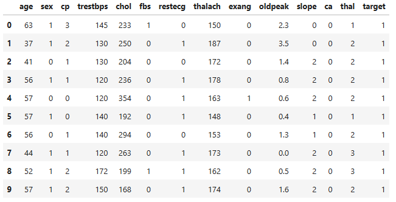

## **Neural Networks: Heart Disease Classification**

**Project description:** The goal is to create a classification model that can accurately predict whether a patient will or won't have heart disease based on their recorded health metrics.  

>**Source:** The dataset was obtained from the [Heart Disease Classification - Neural Network](https://www.kaggle.com/rajeshjnv/heart-disease-classification-neural-network/data) Kaggle Notebook data page. 

### Expected Correlations to the Target Feature

The following statements summarise the correlations that were expected based on common public health information.  

- Age negatively correlates (expected that younger particpants would be **less** likely to have heart disease)
- High blood pressure (trestbps) positively correlates (expected that those with higher blood pressure would be **more** likely to have heart disease) 
- Chest pain (cp) negatively correlates (expected that those with recorded chest pain for typical or atypical angina would be **more** likely to have heart disease)
- High cholesterol (chol) ositively correlates (expected that those with higher cholesterol would be **more** likely to have heart disease)  


<!-- **import**{: style="color: green;" } -->


### Getting the imports and data

```python
import numpy as np 
import numpy.matlib
import pandas as pd 
import matplotlib.pyplot as plt  
from scipy.spatial import distance_matrix
from scipy.cluster.hierarchy import dendrogram, linkage
from sklearn.cluster import AgglomerativeClustering
import seaborn as sns 
from sklearn.preprocessing import RobustScaler
from sklearn.ensemble import RandomForestClassifier
from sklearn import tree
from sklearn.linear_model import LogisticRegression
from sklearn.metrics import average_precision_score
from sklearn.model_selection import cross_val_score
from sklearn.metrics import precision_recall_curve
from sklearn.neighbors import KNeighborsClassifier
from sklearn.tree import DecisionTreeClassifier
from sklearn.datasets import make_classification
from sklearn.model_selection import train_test_split
from sklearn.metrics import confusion_matrix
from sklearn.metrics import accuracy_score
from sklearn.naive_bayes import GaussianNB
from sklearn.metrics import roc_curve
from sklearn.metrics import roc_auc_score
from sklearn.metrics import f1_score
from sklearn.metrics import auc
from sklearn.svm import SVC
%matplotlib inline
```

```python
heart = pd.read_csv('heart.csv')
heart.head(10)
```


#### Column Names Explained
- age = age in years
- sex = male or female (1 = male; 0 = female)
- cp = chest pain type
- trestbps = resting blood pressure (in mm Hg on admission to the hospital)
- chol = serum cholesterol (in mg/dl)
- fbs = fasting blood sugar (> 120 mg/dl, 1 = true; 0 = false)
- restecg = resting electrocardiographic results
- thalach = maximum heart rate achieved
- exang = exercise induced angina (1 = yes; 0 = no)
- oldpeak = ST depression induced by exercise relative to rest ('ST' relates to positions on the ECG plot.)
- slope = the slope of the peak exercise ST segment (Value 1: upsloping, Value 2: flat, Value 3: downsloping)
- ca = The number of major vessels (0-3)
- thal = A blood disorder called thalassemia (3 = normal; 6 = fixed defect; 7 = reversible defect)
- target = Heart disease (0 = no, 1 = yes)

#### Data Quality Assessment
```python
heart.describe()
```

```python
heart.info()
```
```python
heart.isnull().sum()
```
```python
heart.shape
```

**Overview of the Data**

- There are no missing/null values
- All data is numerical (everything int except oldpeak which is float)
- There are 303 rows/samples and 14 columns/features
- Age range is from 29 to 77 years with mean age of 54 years (to 2 s.f.).
- The data is not normalised: some feature values range between 0 and 1 whilst others between 0 and 100s.

**Considerations**

- As the distributions for each feature are not all gaussian bell curves and the dataset contains features with different ranges and varying scales, the dataset requires normalistion.
- The normalisation will change the values of numeric columns in the dataset to a common scale, without distorting differences in the ranges of values.
- Normalisation is being performed so that features with larger ranges won't intrinsicaly have more influence on the results (i.e. what the main predictors are for heart disease) than features with smaller ranges. In other words, we don't want to conflate feature size with feature importance as a predictor.
- The algorithms to be used on this data (artificial neural networks, k-nearest neighbours) do not make assumptions about the data distribution. As such, standardisation is not being used to transform the data (standardisation assumes normally distributed data and requires that the selected algorithms assume normal distribution too e.g. logistic regression).
- One way to normalise the data is to use MinMaxScaler which rescales the data set such that all feature values are in the range [0, 1].
- It must be noted however, MinMaxScalar is sensitive to outliers (compared to StandardScaler) because it does not use a bounded range with smaller standard deviations, which would have suppressed the effects of outliers.
- There are many normalisation techniques to choose from on scikit-learn so it will be important to select the right one for this dataset. [See here](https://scikit-learn.org/stable/auto_examples/preprocessing/plot_all_scaling.html#sphx-glr-auto-examples-preprocessing-plot-all-scaling-py) for scikit-learn's article "Compare the effect of different scalers on data with outliers".
- To decide which is the best, visual data quality assessments now need to be performed.

>**Source:** For more information on normalisation and how to know when to use standardisation vs normalisation [click here](https://towardsai.net/p/data-science/how-when-and-why-should-you-normalize-standardize-rescale-your-data-3f083def38ff) and [here](https://beginanalyticsblog.wordpress.com/2019/07/10/normalizing-numeric-variables-in-python/).

### 3. Support the selection of appropriate statistical tools and techniques


### 4. Provide a basis for further data collection through surveys or experiments

Sed ut perspiciatis unde omnis iste natus error sit voluptatem accusantium doloremque laudantium, totam rem aperiam, eaque ipsa quae ab illo inventore veritatis et quasi architecto beatae vitae dicta sunt explicabo. 

See the full [Jupyter Notebook](notebooks/heart_clf.html).
